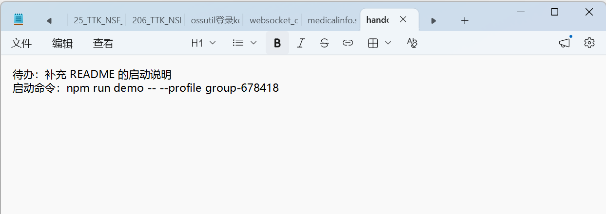
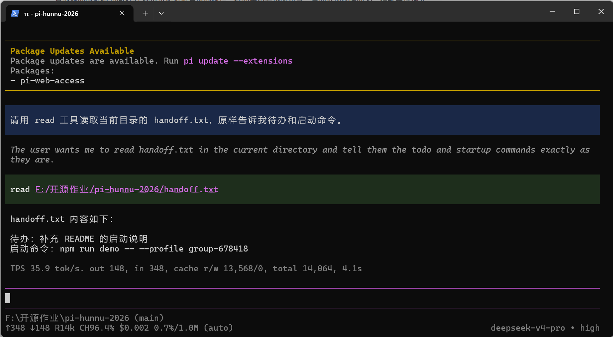
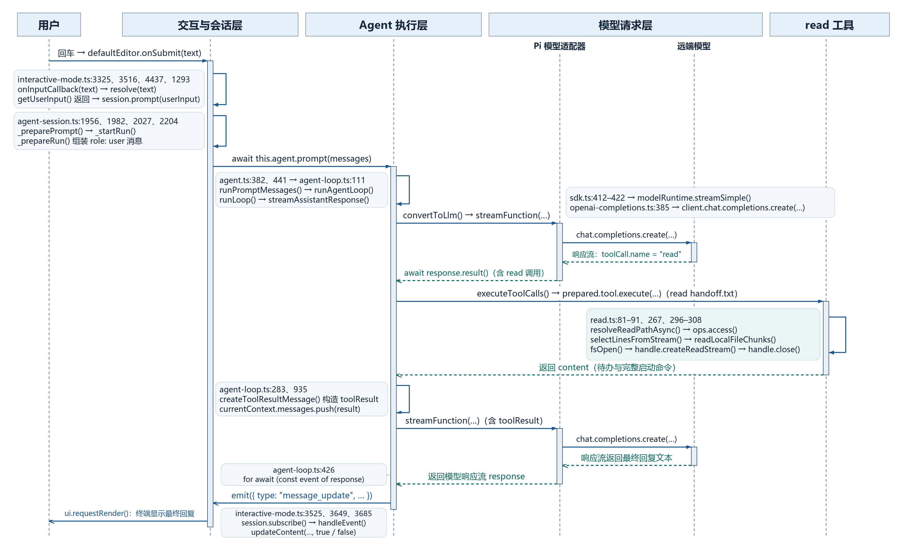
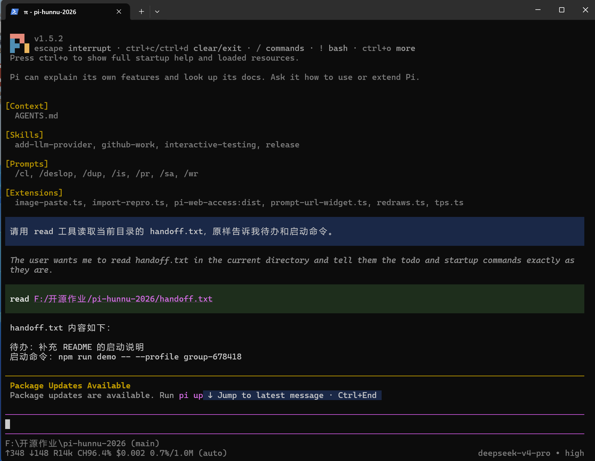
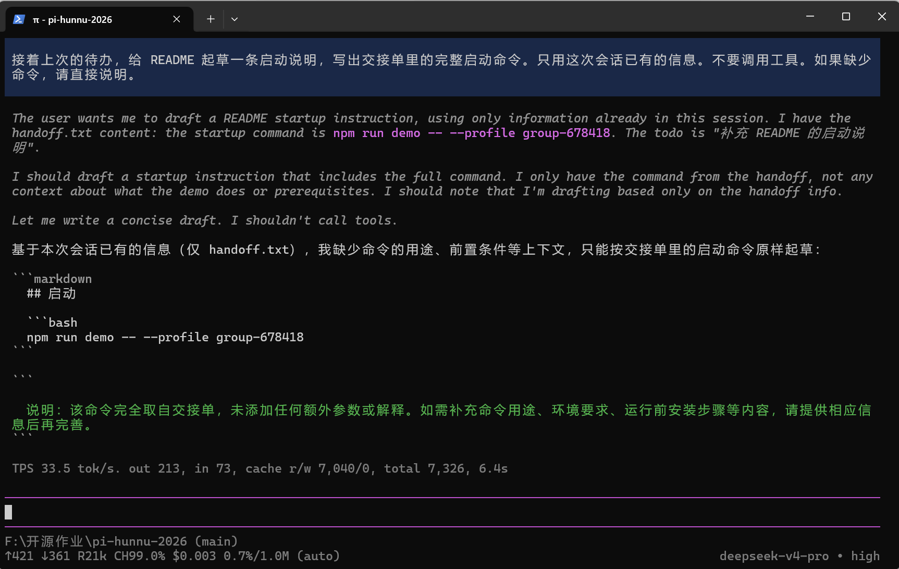
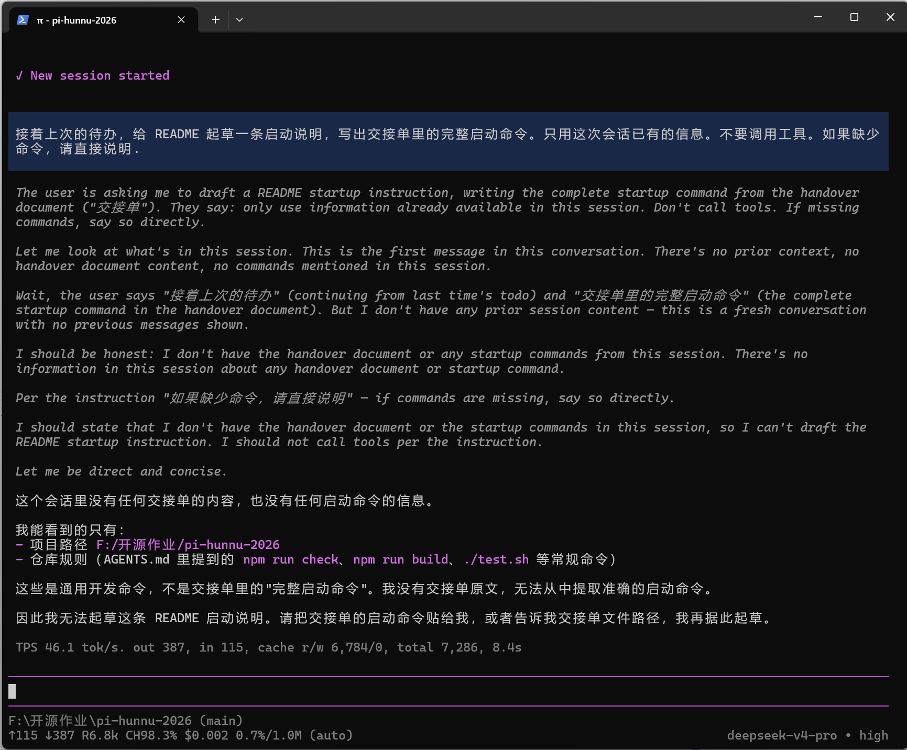
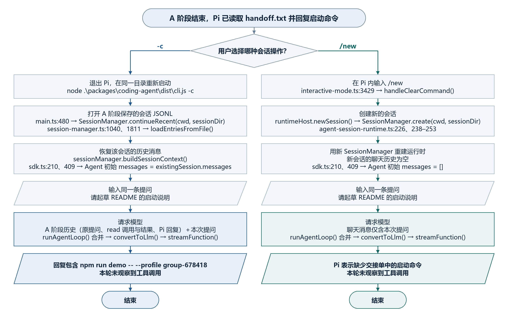

# 实践课 5：Pi Agent 源码泛读与功能定位实验报告

## 基本信息

- 姓名　邓鑫
- 学号　202430224057
- GitHub 用户名　[dx0110](https://github.com/dx0110)
- 个人作业仓库　[dx0110/05-Pi-Agent-source-reading](https://github.com/dx0110/05-Pi-Agent-source-reading)
- 小组源码仓库　[MangDui/pi-hunnu-2026](https://github.com/MangDui/pi-hunnu-2026)

## 目录

- [一、实验目的与环境](#一实验目的与环境)
- [二、实验过程与结果](#二实验过程与结果)
  - [任务 A 单轮交互与工具调用](#任务-a-单轮交互与工具调用)
  - [任务 B 恢复旧会话与新建会话](#任务-b-恢复旧会话与新建会话)
- [三、任务书问题作答](#三任务书问题作答)
  - [1. 从输入到 Agent 循环](#1-从输入到-agent-循环)
  - [2. 模型请求与文件读取](#2-模型请求与文件读取)
  - [3. 工具结果与终端回复](#3-工具结果与终端回复)
  - [4. 两种会话发送给模型的消息](#4-两种会话发送给模型的消息)
- [四、实验总结](#四实验总结)

## 一、实验目的与环境

沿用之前在 Windows 上构建的 Pi，先用一次真实的文件读取追踪从终端输入到模型回复的调用链，再对照 `-c` 和 `/new`，弄清楚会话历史从哪里来、会把哪些聊天消息交给模型。源码行号均按本地检出的文件记录。

| 项目 | 实际环境 |
| --- | --- |
| Node.js | `v24.16.0` |
| 工作目录 | `F:\开源作业\pi-hunnu-2026` |
| 本地 CLI | `packages/coding-agent/dist/cli.js`，终端显示 Pi `v1.5.2` |
| 模型 | `deepseek-v4-pro`，会话记录中的提供方为 `deepseek` |

## 二、实验过程与结果

### 任务 A 单轮交互与工具调用

在源码仓库根目录新建 `handoff.txt`，随机生成的标识是 `group-678418`。文件里写了两行。

~~~text
待办：补充 README 的启动说明
启动命令：npm run demo -- --profile group-678418
~~~

核对本地 CLI 路径时，`Test-Path .\packages\coding-agent\dist\cli.js` 返回 `True`。在同一目录运行下面的命令，然后在 Pi 中发出一条提问，问题里只给出文件名。

~~~powershell
node .\packages\coding-agent\dist\cli.js
~~~

> 请用 read 工具读取当前目录的 handoff.txt，原样告诉我待办和启动命令。

终端显示一次对 `F:/开源作业/pi-hunnu-2026/handoff.txt` 的 `read` 调用，随后给出了待办和带随机标识的完整命令。会话 JSONL 也记录了这一轮的顺序：一条用户消息、带 `read` 调用的模型响应、一条成功的工具结果、给出完整命令的模型响应。这里的一轮交互共包含两次模型响应和一次工具执行。

**图 1　单轮工具调用的代码级时序图(相关说明在问题回答1-3节)**

[图 1 可编辑 Draw.io 图源](../images/figure-1-tool-call.drawio)

### 任务 B 恢复旧会话与新建会话

退出 Pi 后，在原目录用 `-c` 重新启动，终端里重新出现了 A 阶段的提问、`read` 记录和回复。完成追问后，再输入 `/new`，等待终端显示 `New session started`，保持工作目录和模型不变，发出完全相同的提问。

~~~powershell
node .\packages\coding-agent\dist\cli.js -c
~~~

> 接着上次的待办，给 README 起草一条启动说明，写出交接单里的完整启动命令。只用这次会话已有的信息。不要调用工具。如果缺少命令，请直接说明。

| 会话 | 实际回复 | 该轮工具调用 |
| --- | --- | --- |
| `-c` 恢复旧会话 | 给出了启动说明草稿，其中包含 `npm run demo -- --profile group-678418` | 没有新增工具调用 |
| `/new` 新建会话 | 说明本会话缺少交接单内容，无法给出完整启动命令 | 没有工具调用 |

重新启动时屏幕上出现的 `read` 来自 A 阶段。当时容易把它算进 B 阶段，核对会话记录后可以看到，旧会话的 `toolResult` 在第二条用户消息之前，两次 B 阶段回复中也都没有工具调用。新会话虽然还能看到项目路径和仓库规则，但没有 A 阶段的交接单内容。

| 恢复旧会话后的回复 | 新建会话后的回复 |
| --- | --- |
|  |  |

**图 2　恢复旧会话与新建会话的对照图（相关说明在问题回答第4节）**

[图 2 可编辑 Draw.io 图源](../images/figure-2-session-comparison.drawio)

## 三、任务书问题作答

### 1. 从输入到 Agent 循环

我从 `packages/coding-agent/src/modes/interactive/interactive-mode.ts` 第 3324 行的 `setupEditorSubmitHandler()` 开始查。空闲时提交普通文本，`onSubmit` 会在第 3516–3519 行唤醒 `onInputCallback`，或者把文本放入 `pendingUserInputs` 等待消费。等待中的 `getUserInput()` 通过 `resolve(text)` 返回输入（第 4436–4441 行），交互循环随后调用 `await this.session.prompt(userInput)`（第 1293–1296 行）。

`packages/coding-agent/src/core/agent-session.ts` 的 `AgentSession.prompt()` 先调用 `_preparePrompt()`，再调用 `_startRun()`（第 2175、2204–2208 行）。`_startRun()` 通过 `_prepareRun()` 组装 `role: "user"` 的消息，最终在第 1982 行执行 `await this.agent.prompt(messages)`。到了 `packages/agent/src/agent.ts`，`Agent.prompt()` 经 `runPromptMessages()` 进入 `runAgentLoop()`，它把本次消息接在已有上下文后，再启动 `runLoop()`（`agent.ts` 第 382–389、441–453 行，`agent-loop.ts` 第 111–133 行）。

### 2. 模型请求与文件读取

- **模型边界。** `packages/agent/src/agent-loop.ts` 的 `streamAssistantResponse()` 先用 `convertToLlm()` 转换消息，再调用 `streamFunction()`（第 391–419 行）。`packages/coding-agent/src/core/sdk.ts` 第 412–422 行将调用交给 `modelRuntime.streamSimple()`。本次 JSONL 的模型响应记录为 `provider: deepseek`、`api: openai-completions`。本地 `packages/ai/src/providers/deepseek.ts` 第 6–14 行配置了 DeepSeek 的适配器，`packages/ai/src/api/openai-completions.ts` 第 385 行调用 `client.chat.completions.create(...)`。第一段响应流返回了 `read` 调用，工具结果加入上下文后，下一次请求的响应流才给出最终文本。
- **文件边界。** 本轮工具调用记录中的 `offset` 和 `limit` 都是 `null`。Agent 在执行前用 `validateToolArguments()` 校验参数（`agent-loop.ts` 第 738 行），可选字段的 `null` 按省略处理（`packages/schema/src/coerce.ts` 第 112–147 行）。因此对这个普通文本文件，`packages/coding-agent/src/core/tools/read.ts` 第 296–308 行选择 `selectLinesFromStream()`。默认读取操作 `readLocalFileChunks()` 会通过 `fsOpen()` 打开文件，用 `handle.createReadStream()` 读取，最后关闭句柄（第 68–91 行）。这一次走的是文本流式分支。

### 3. 工具结果与终端回复

模型返回含工具调用的消息后，`agent-loop.ts` 的 `runLoop()` 进入 `executeToolCalls()`，最终调用 `prepared.tool.execute(...)`（第 267–284、837 行）。在工具返回后，`createToolResultMessage()` 将其整理成 `role: "toolResult"` 的消息，循环用 `currentContext.messages.push(result)` 把它放入下一次模型请求使用的上下文（第 283–286、935–947 行）。交接单中的命令因此出现在工具结果里，也出现在紧接着的模型回复里。

显示端回到 `interactive-mode.ts`。`subscribeToAgent()` 用 `session.subscribe()` 接收会话事件，再交给 `handleEvent()`（第 3525–3528 行）。`message_update` 分支调用 `streamingComponent.updateContent(..., true)` 和 `ui.requestRender()`，用户可以在终端看到逐步更新的回复。`message_end` 分支再用 `updateContent(..., false)` 更新最终内容（第 3649–3698 行）。

### 4. 两种会话发送给模型的消息

**旧会话如何恢复。** `packages/coding-agent/src/cli/args.ts` 第 111 行把 `-c` 和 `--continue` 解析为同一个选项。`packages/coding-agent/src/main.ts` 第 479–480 行据此调用 `SessionManager.continueRecent(cwd, sessionDir)`。`session-manager.ts` 第 1811–1818 行查找会话目录中的最近会话，存在时打开对应文件，第 1040 行用 `loadEntriesFromFile()` 加载记录。A 阶段的用户消息、助手消息和工具结果在 `agent-session.ts` 的 `message_end` 处理中由 `sessionManager.appendMessage()` 写入会话（第 1228–1232 行）。重启后，`sdk.ts` 用 `buildSessionContext()` 取出历史消息，并将其作为 Agent 的初始 `messages`（第 210、403–409 行）。

**新会话如何建立。** `interactive-mode.ts` 第 3429–3432 行识别 `/new`，通过 `handleClearCommand()` 调用 `runtimeHost.newSession()`（第 7117–7125 行）。`agent-session-runtime.ts` 第 226–253 行创建新的 `SessionManager` 并重建运行时，本次新会话的聊天历史从空列表开始。

在两条路径中，`runAgentLoop()` 都会把本次提问接到当前上下文，再经 `convertToLlm()` 转换成模型消息（`agent-loop.ts` 第 119–124、398–419 行）。旧会话发送的聊天消息包括 A 阶段原提问、带 `read` 调用的助手消息、`toolResult`、助手回复和本次提问。新会话发送的聊天消息只有本次提问，系统提示和仓库规则仍可随请求提供。旧会话能复述完整命令、新会话说明缺少命令，与这两条源码路径和会话记录相符。

## 四、实验总结

这次从 `onSubmit` 一直查到本地文件流和模型响应，最容易混淆的是用户提问次数、模型调用次数和工具执行次数。A 阶段只按了一次回车，会话记录里却有两条模型响应，中间夹着一条 `read` 的工具结果。B 阶段则用同一个问题验证了恢复历史的作用，恢复后的 Pi 当场给出了完整命令，而且没有再读文件。

以后要调整终端如何显示回复，可以从 `interactive-mode.ts` 的事件分支入手。要调整文件读取范围或截断规则，应看 `core/tools/read.ts`。要调整恢复时选哪个会话或如何重建历史，则分别从 `SessionManager.continueRecent()` 和 `buildSessionContext()` 查起。

